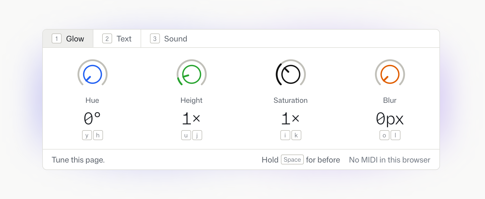

# Quadknob

Four knobs to dial values in by eye, after the OP-1. An agent skill that puts a panel of knobs in your running page, so
you can tune radii, type, colour, timing and the like by turning them rather than by guessing numbers.

**[Read the story behind it: Four knobs →](https://githubnext.com/posts/four-knobs/)**



## Install

```sh
npx skills add githubnext/quadknob-skill
```

Then ask your agent to dial something in, or mention Quadknob by name.

## Without the skill

The skill is a thin wrapper around one dependency-free web component, `quadknob.js`. Copy it into your site's static
files, load it, and put a `<quadknob-panel>` on the page with up to four values. Turn the knobs, then press Done to copy
the values you landed on. `SKILL.md` describes every attribute and the drawings it comes with.

```html
<script type="module" src="/quadknob.js"></script>
<quadknob-panel
  floating label="Card" figure="frame"
  css=".card { border-radius: {radius}px; padding: {padding}px }"
  params='[
    {"name": "radius",  "label": "Radius",  "stops": "radius",  "default": 8},
    {"name": "padding", "label": "Padding", "stops": "spacing", "default": 16}
  ]'
></quadknob-panel>
```
